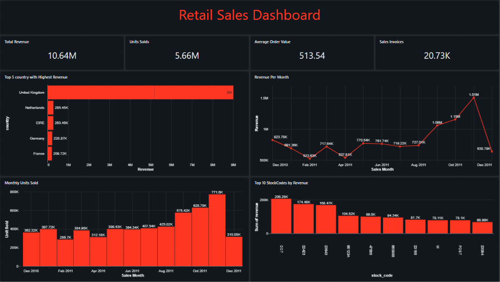

# Online Retail Sales Analysis

 I used Databricks SQL to explore a real retail transaction dataset, preserve the original records, build Silver and Gold tables, and create a sales dashboard.

The project helped me practise the full analytics workflow: understanding the source data, checking data quality, defining business rules, building reusable tables, validating aggregations, and presenting sales metrics.

## Business context

The dataset contains transactions from a UK-based online retailer that sells gifts. The data covers December 1, 2010 through December 9, 2011. Many customers were wholesalers.

I approached the work as an analyst supporting the retailer’s sales team. The dashboard is designed to help review sales over time and compare sales across countries and products.

## Questions this project is designed to explore

- How do revenue and units sold change over time?
- How do sales vary by country?
- Which product codes contribute the most revenue?
- How many invoices and sales lines are included in the sales view?

This README documents the project structure and metric definitions. It does not claim causal explanations for sales patterns.

## Dataset

- **Source:** [UCI Machine Learning Repository — Online Retail](https://archive.ics.uci.edu/dataset/352/online%2Bretail)
- **Original file:** `Online Retail.xlsx` (22.6 MB)
- **Rows:** 541,909
- **Period:** December 1, 2010 to December 9, 2011
- **Currency:** Sterling (GBP), according to the UCI dataset documentation
- **License:** [Creative Commons Attribution 4.0 International](https://creativecommons.org/licenses/by/4.0/)

The original file was converted to CSV for ingestion into Databricks. The converted CSV was approximately 43.47 MB. The raw dataset is not included in this repository; download it from UCI and follow the ingestion steps in the SQL notebook.

### Source columns

| Column | Description |
|---|---|
| `InvoiceNo` | Invoice identifier. A value beginning with `C` marks a cancellation. |
| `StockCode` | Product code. |
| `Description` | Product description. |
| `Quantity` | Number of items on the transaction line; negative values are preserved. |
| `InvoiceDate` | Transaction date and time. |
| `UnitPrice` | Unit price in sterling. |
| `CustomerID` | Customer identifier; some records have no customer ID. |
| `Country` | Customer’s country. |

Databricks also added `_rescued_data` during ingestion. It was checked and had no non-null values.

## Tools

- **Databricks SQL:** data profiling, transformations, quality checks, and Gold aggregations
- **Unity Catalog:** Bronze, Silver, and Gold tables
- **Databricks AI/BI Dashboard:** KPI cards and visualizations
- **GitHub:** project documentation and version control



## Data model and process

### Bronze

`workspace.retail_project.bronze_online_retail_raw`

The raw CSV was ingested with the eight source columns stored as strings. Keeping the original values in Bronze made it possible to inspect and validate the source before converting types.

### Silver

`workspace.retail_project.silver_online_retail`

Silver contains one row per Bronze row. It trims string fields, converts quantity to an integer, converts unit price to a fixed-point decimal, parses the invoice date, preserves missing values as `NULL`, and adds two independent flags:

- `is_cancellation`: invoice number begins with `C`
- `is_negative_quantity`: quantity is less than zero

Rows were not removed and missing descriptions or customer IDs were not filled in.

### Gold

The Gold tables support sales reporting. The main sales view includes only rows where `Quantity > 0` and `is_cancellation = FALSE`. Cancellation lines and other negative-quantity lines remain available in Silver.

| Table | Grain |
|---|---|
| `gold_sales_summary` | One row per included sales line |
| `gold_sales_daily` | One row per sales date |
| `gold_sales_monthly` | One row per calendar month |
| `gold_sales_by_country` | One row per country |
| `gold_sales_by_stockcode` | One row per stock code |

Revenue is calculated as `Quantity × UnitPrice`, then summed. The source currency is sterling (GBP).

## Data quality and validation

The following checks were completed during the project:

- Bronze and Silver both contain 541,909 rows.
- All Silver quantity, unit-price, and invoice-date values parsed successfully.
- Silver preserves 135,080 missing `CustomerID` values and 1,454 missing `Description` values.
- There are 10,624 negative-quantity rows, including 9,288 rows with a cancellation invoice marker. Negative quantities were preserved and separately flagged.
- Daily, monthly, country, and StockCode Gold totals reconciled to the line-level sales table for units and revenue.

The UCI page reports no missing values, while this project’s ingested copy contains missing customer IDs and descriptions. I preserved and documented the values observed in the actual file used for this analysis.

The source does not specify a timezone. The parsed timestamp is therefore treated as a transaction date and time, without asserting that it represents UTC.

## Dashboard

The Databricks dashboard contains eight widgets:

### KPI cards

- Total Revenue
- Units Sold
- Average Order Value
- Sales Invoices

### Charts

- Top five countries by revenue
- Revenue per month
- Monthly units sold
- Top ten StockCodes by revenue

The final month, December 2011, is partial because the dataset ends on December 9, 2011. Monthly comparisons should take that into account.

## Repository contents

```text
online-retail-sales-analysis/
├── README.md
├── sql/
│   └── retail_sales_analysis.ipynb
│   └── bronze_to_silver.ipynb
│   └── silver_to_gold.ipynb
├── dashboard/
│   └── Retail_Sales_Dashboard.png
└── docs/
    └── data_dictionary.md